<div align="center">
  
</div>

<br>

<div align="center">
  
  
  
  
  
  
  
</div>

<br>

<div align="center">
  <table>
    <tr>
      <td align="center" width="150"><a href="#-screenshots">Screenshots</a></td>
      <td align="center" width="150"><a href="#-what-it-puts-on-screen">What's in it</a></td>
      <td align="center" width="150"><a href="#-the-menu">The menu</a></td>
      <td align="center" width="150"><a href="#-install">Install</a></td>
      <td align="center" width="150"><a href="#-ipc">IPC</a></td>
      <td align="center" width="150"><a href="#-development">Development</a></td>
    </tr>
  </table>
</div>

<br>

---

webb-shell is a desktop shell for [Hyprland](https://hyprland.org/). One bar, 19
modules you can drag anywhere in it, and 24 popup panels: a command menu, file
search, audio and media, Wi-Fi, Bluetooth, a system monitor, a calendar, a
wallpaper carousel, a theme picker, a notification daemon, a lock screen, a
Polkit agent and a coding-agent spend panel.

It is QML on [Quickshell](https://quickshell.org/), so there is no Electron, no
web view and no compiled plugin. The desktop background is drawn by the shell
itself on the Wayland background layer — stills, animated GIFs and looping video
through QtMultimedia — so there is no `swww`/`awww`/`hyprpaper` in the stack.

Colours come from [matugen](https://github.com/InioX/matugen). Picking a
wallpaper regenerates a palette the shell watches and applies live, so every
panel, the bar and the background follow the wallpaper. With a solid
background, the scheme picker's **Seed** card does the same from a colour you
choose instead of an image.

**Custom** in the scheme picker goes further: it opens the whole palette for
editing, one swatch per colour, and renders your edits back through matugen's
own templates on every change. The bar, kitty, GTK, hyprland, btop and the rest
are painted from one palette — never the shell's colours on top of matugen's.
`S` saves the palette under a name, and saved palettes become cards in the
Custom tab beside the editor, so a palette worth keeping is one keypress away
instead of re-derived by hand. They live in
`~/.config/webb-shell/palettes.json` (name → matugen's own palette JSON), which
`install.sh` neither writes nor rewrites.

In the picker the mode row is four tabs — Dark, Light, Smart, Custom. `↑`/`↓`
switch tab, `←`/`→` pick a card, `⏎` opens or applies the highlighted card and
`Esc` closes. The first three tabs show the scheme wheel, whose last card is
**Seed**: the single colour the palette is generated from. **Custom** swaps the
wheel for its own set: the **Custom** door card, then one card per saved
palette. `⏎` on the door edits every colour in the palette; `⏎` on a saved card
opens that palette in the same editor (its name is what `s` prefills, so saving
refines that card), `a` applies it without opening the editor, and `d` deletes
it (twice, to be sure).
Inside the editor `↑`/`↓` switch between hue, saturation and lightness,
`←`/`→` adjust the focused one (`Shift` for ten steps), `Tab` moves to the next
colour, `c` copies the highlighted colour and `v` pastes it onto the highlighted
row, `s` saves the palette as a named card, `⏎` applies it and `Esc` puts the
previous colours back.

The picker beside the list answers what the highlighted colour controls under
**WHAT CHANGES**, in the order you would notice it. Every line names the piece of
the shell that repaints, not a widget class:

- **the shell's own widgets first**, one line per place: for `primary` that is the
  bar's open-but-unfocused workspace numbers, an accent pill button's fill, the
  menu's filter ring and selected row, the system monitor's graph line below 70 %,
  the lock screen's password field ring, the weekday on the on-screen clock and
  today's calendar cell, and the wifi/audio/bluetooth/find popups' accent. The
  table lives in `src/popups/PaletteTokens.js`.
- **In the terminal:** the kitty slots, read off the kitty template — cursor, ANSI
  bright blue, active tab, window border.
- **In Hyprland:** the compositor setting, read off your own Lua config in
  `~/.config/hypr`, so it names the real thing: `secondary_container` is the
  active window border, `outline_variant` the inactive one.
- **Other app themes:** every other template in `~/.config/matugen/config.toml`
  that mentions the role.

The last three are derived at runtime by `bin/palette.sh usage`, so they follow
the machine's own config instead of a table in the repo that could drift. When
nothing on screen reads the role the first line says so outright — "nothing you
can see — no bar, popup, terminal or window border reads it" — and the remaining
line names the app theme that still does. Rows in the list whose colour paints
nothing visible are dimmed for the same reason, and the list column grows to the
height of the longest explanation instead of scrolling.

A miniature preview of the shell with the painted regions ringed was tried and
removed: it was prettier and less informative than the sentence it replaced, and
so was a one-line summary per colour.

It owns the session's idle behaviour too, rather than deferring to `hypridle`:
the screen dims, then the display goes off and the screen locks, on three
configurable timeouts that respect other applications' idle inhibitors, with a
Stay Awake toggle for when they get in the way.

No fixed paths and no symlinks: every script and component resolves the
repository at runtime, and per-machine values live in one config file.

<br>

---

## ✦ Screenshots

<table>
  <tr>
    <td width="50%"><a href="docs/screenshots/menu.png">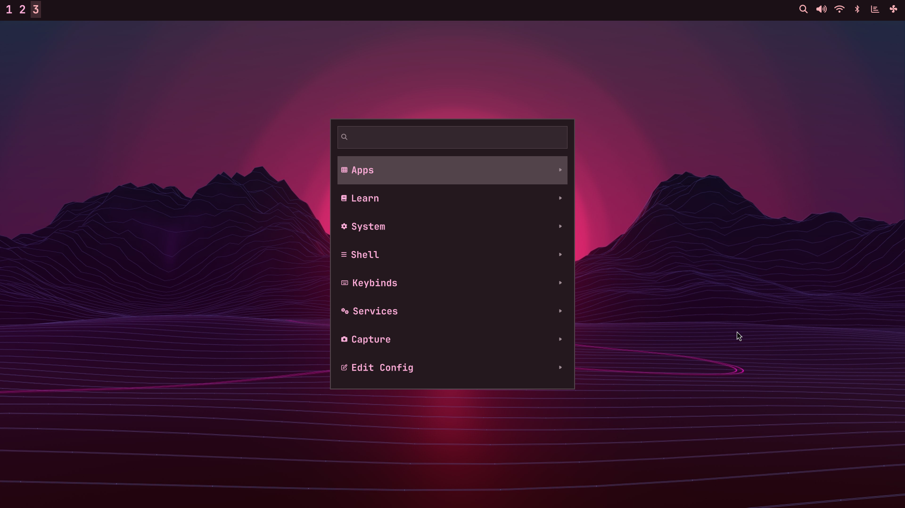</a></td>
    <td width="50%"><a href="docs/screenshots/find.png">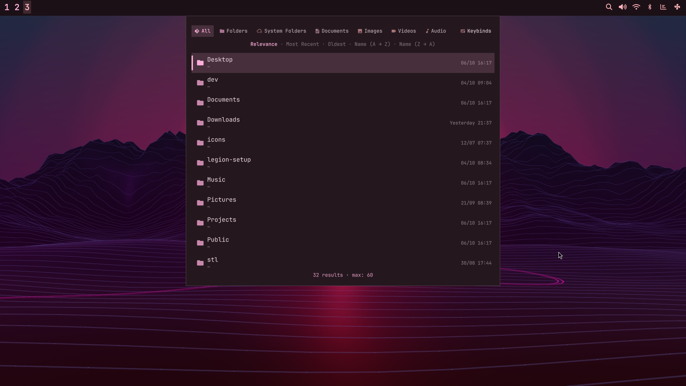</a></td>
  </tr>
  <tr>
    <td><a href="docs/screenshots/audio.png">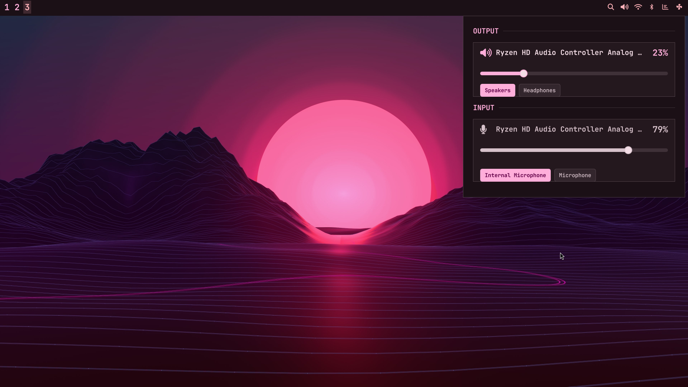</a></td>
    <td><a href="docs/screenshots/wifi.png">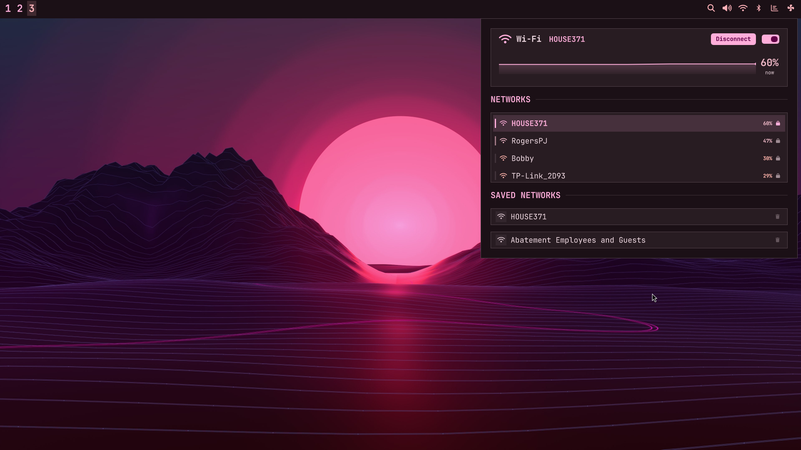</a></td>
  </tr>
  <tr>
    <td><a href="docs/screenshots/system.png">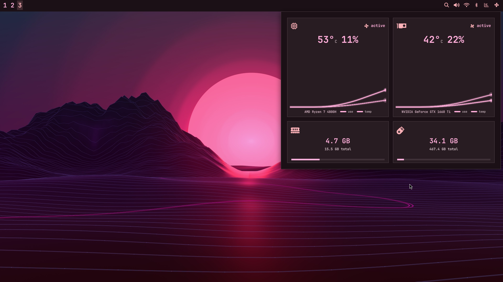</a></td>
    <td><a href="docs/screenshots/usage.png">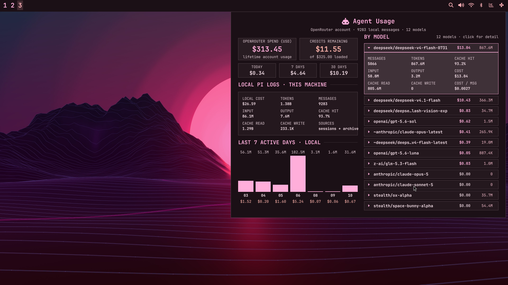</a></td>
  </tr>
  <tr>
    <td><a href="docs/screenshots/glance.png">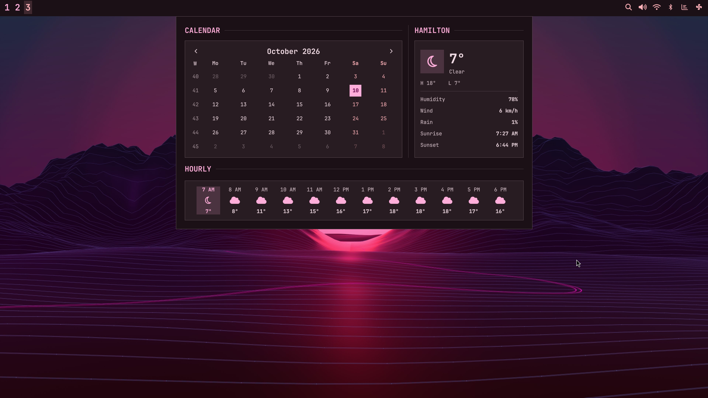</a></td>
    <td><a href="docs/screenshots/wallpaper.png">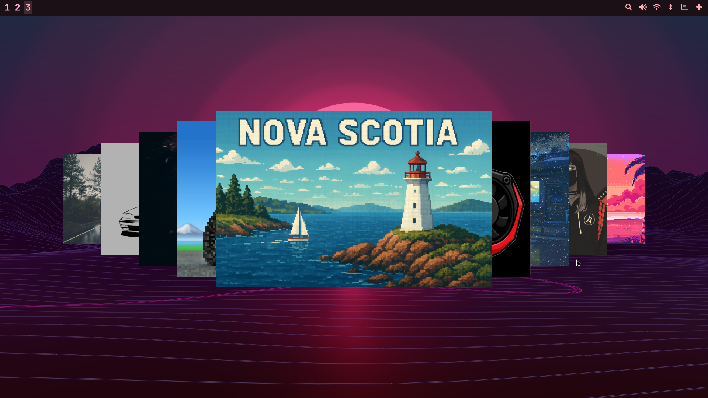</a></td>
  </tr>
  <tr>
    <td><a href="docs/screenshots/scheme.png">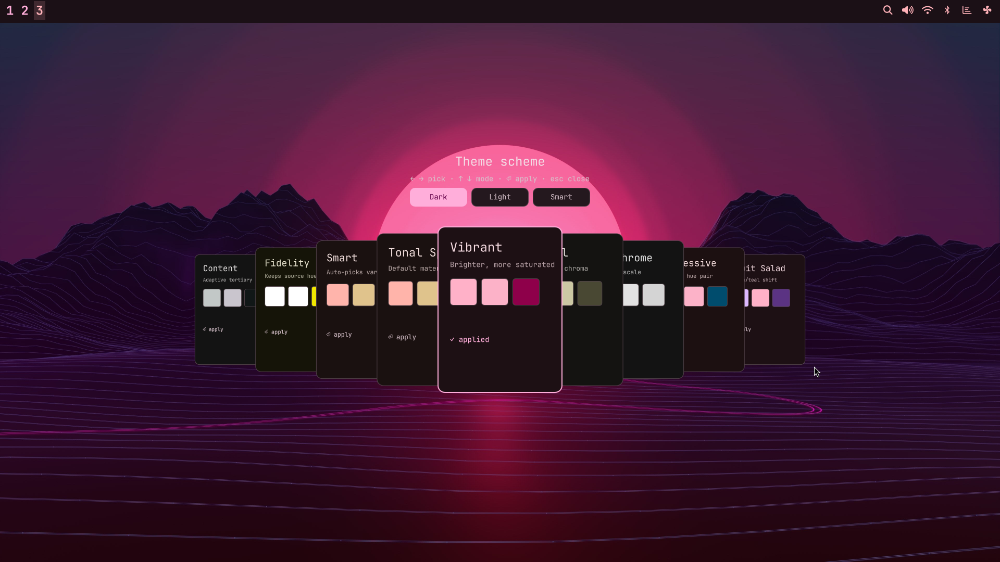</a></td>
    <td><a href="docs/screenshots/bar-settings.png">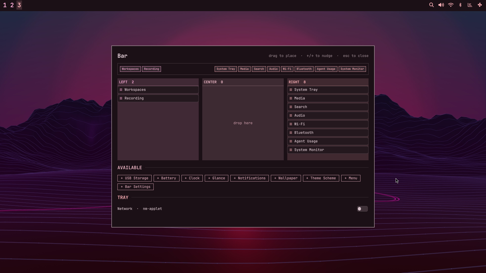</a></td>
  </tr>
  <tr>
    <td><a href="docs/screenshots/keybinds.png">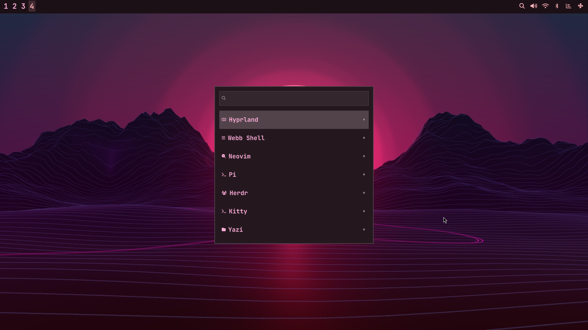</a></td>
    <td><a href="docs/screenshots/history.png">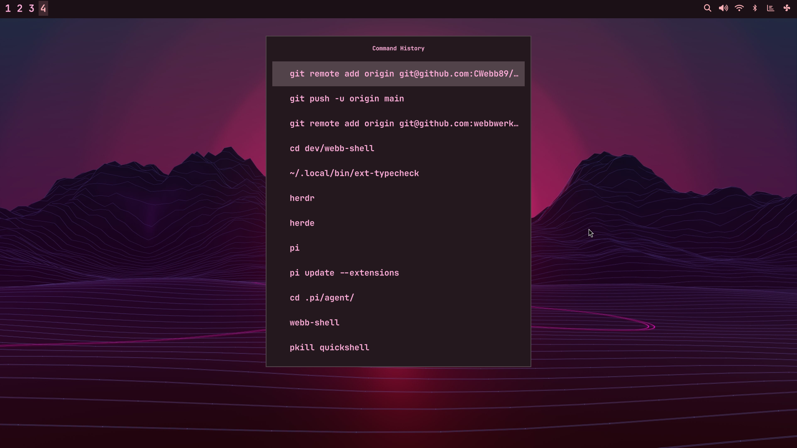</a></td>
  </tr>
</table>

Twelve panels, captured at 1920×1080. Click any shot for full resolution;
`docs/screenshots/README.md` records how they were taken and which panels are
still missing.

<br>

---

## ✦ What it puts on screen

The bar is a catalogue of 22 modules. Each one is either always visible, or hides
itself when it has nothing to say — and the whole arrangement is yours to change
from Bar Settings, including per-module placement and which section of the bar it
belongs to.

| Module | What it does |
| --- | --- |
| **Workspaces** | Hyprland workspace digits, click to switch |
| **Media** | Now-playing art, title and transport controls |
| **Tray** | Status-notifier icons, with a filter for entries you never want |
| **Recording** | A pulsing dot while `gpu-screen-recorder` is running |
| **Find** | File search over `fd`, scoped to indexed folders |
| **Notes** | Scratch notes with add, edit, copy and delete |
| **Audio** | Volume, output and input devices, and the media card |
| **Wi-Fi** | Scan, connect, forget, saved networks |
| **Bluetooth** | Paired devices, scan, adapter power |
| **System** | CPU and GPU temperature, load, fan, memory, disk, per-core |
| **USB Storage** | Mounted drives with safe eject — hidden when there are none |
| **Agent Usage** | Coding-agent spend for the provider pi used last — OpenRouter spend and credits, DeepSeek balance, local per-provider token and cache breakdowns for any provider; hidden when unavailable |
| **Phone** | KDE Connect device: battery, signal and reachable state in the bar; the panel adds phone media control, mount-and-browse of the phone's storage, clipboard push, ring, ping and SMS |
| **Battery** | Charge card, and it raises itself when the battery is low |
| **Clock** | The clock OSD |
| **Glance** | Month calendar and weather, hourly and daily |
| **Notifications** | Notification history you can read and prune |
| **Wallpaper** | Full-screen carousel over your wallpaper directory |
| **Theme Scheme** | matugen scheme picker: tints, variants, plus a Seed card for a colour you pick and a Custom palette editor for all 50 tokens, with saved palettes as cards |
| **Menu** | The `SUPER+D` command menu |
| **Bar Settings** | Drag-and-drop bar layout, module palette, tray filter |

Not everything is a bar module. There is also a lock screen, a Polkit agent, a
notification daemon with toasts and Do-Not-Disturb, reminders, a tray menu, and a
3D-printing wallpaper transition that plays when a print starts.

Two things live outside the bar's own surface because they take input: **Phone**
(the KDE Connect panel) and **Text from Screen** — `bin/ocr.sh` picks a region,
OCRs it with tesseract, and puts the text on the clipboard.

<br>

---

## ✦ The menu

`SUPER+D` opens a menu whose entire contents live in `src/menu/menu.jsonc` — 382
rows, and the logic that reads them is a pure JS module with no QML in it. Eight
sections hold them: **Apps**, **Panels**, **System**, **Settings**, **Software**,
**Services**, **Capture**, **Reference**. A row belongs under Panels when it
raises a shell surface; anything that changes shell or desktop configuration
belongs under Settings; package management never sits under System.

Hierarchy comes from dotted IDs (`system.session.lock` is a child of
`system.session`, which sits under `system`), and the
kind of a row is inferred from which key it carries: `action` runs something,
`open` hands off to a panel the shell already has, `toggle` flips state, and
children make it a submenu. `@shellDir@` expands to the repository path at load
time, so entries stay portable.

Three conditions shape what you see:

- `when` hides a row, and prunes a submenu that ends up empty
- `disabled` dims a row and excludes it from selection and search
- `checked` renders evaluated state, so toggles read as on or off

All of a row's guard expressions batch into **one** Bash process per evaluation
rather than forking per row, and they re-evaluate on every open — without that,
state went stale and an installed application kept offering to install itself.

Search is global across the whole tree and ranks label matches above section,
description and alias matches. Hand-off rows open the panel that already exists
instead of rebuilding it, and an app row is ranked by how often you have launched
it.

<br>

---

## ✦ Install

Needs Quickshell 0.3.1+, a Hyprland session, and **JetBrainsMono Nerd Font
Mono** — most icons are Nerd Font glyphs. matugen is optional; without it the
shell falls back to a baked-in palette.

```fish
git clone https://github.com/CWebb89/webb-shell.git
cd webb-shell
./install.sh              # tool check + config + matugen template + systemd unit
./install.sh --packages   # also install the runtime and desktop package sets
```

Then add one line to your Hyprland config:

```ini
exec-once = quickshell -p /path/to/webb-shell
```

`install.sh` writes `~/.config/webb-shell/config.json`, registers the matugen
**quickshell** colour template additively (backing up your `matugen/config.toml`
once and never rewriting your other template blocks), installs `bin/webb-shell`
and `bin/shot` into `~/.local/bin`, and renders `systemd/webb-shell.service`
into `~/.config/systemd/user/` and enables it — so the shell starts with
`graphical-session.target` and a crash restarts it. It is idempotent — re-running
is safe, and unknown keys in your config are preserved. No step needs root: the
lock screen reads `src/assets/pam.d/webb-shell` from the checkout through
`PamContext.configDirectory`, so nothing is installed into `/etc`.

`install.sh --packages` is the only mode that touches pacman. It installs the
runtime dependencies plus a curated desktop package set. That list is
**hand-maintained, not a `pacman -Qqe` dump**: kernels, bootloaders and vendor
GPU drivers are deliberately omitted because they would be wrong on other
hardware, and the AUR-only entries need `yay -S` afterwards.

For a second machine — and for bringing an older copy of this shell up to date —
follow [`docs/OTHER-PC.md`](docs/OTHER-PC.md), which covers what `install.sh`
deliberately does not touch: autostart and keybinds, capture tooling, fonts, the
notification daemon, and the wallpaper record.

### What you need

| | |
| --- | --- |
| **Required** | `quickshell` 0.3.2, `matugen`, `jq`, `NetworkManager`, `wireplumber`, `bluez`, `udisks2`, `grim`, `slurp`, `wl-clipboard` |
| **Video wallpapers** | `qt6-multimedia`, `qt6-multimedia-ffmpeg` |
| **Media control** | `Quickshell.Services.Mpris` (ships with Quickshell), and `mpv-mpris` for video played through mpv |
| **Optional** | `pavucontrol-qt`, `fd`, `fzf`, `tesseract`, `zbar`, `gpu-screen-recorder`, `cliphist`, `hyprpicker`, `localsend` |

Everything optional degrades: a missing tool hides or fails only its own feature.
The shell deliberately has no Wi-Fi QR row — NetworkManager will not hand a PSK
to an unprivileged process, and a QR without the password is not worth a menu
entry.

`mpv-mpris` is worth calling out, because browser media is not: Chromium exposes
no MPRIS player at all, so a YouTube tab is invisible to the shell no matter what
you install. Video played through mpv is controllable as soon as
`/etc/mpv/scripts/mpris.so` exists, which is what that package installs.

> **Lock screen:** if your compositor session does not allow Quickshell to take
> the layer shell while locked, keep using your normal lock workflow. The shell's
> lock is a thin alternative, not a requirement for anything else here.

<br>

---

## ✦ Configuration

One file, `~/.config/webb-shell/config.json`:

```json
{
  "wallpaperDir": "/home/you/pictures/wallpapers",
  "cpuName": "AMD Ryzen 7 ...",
  "gpuName": "NVIDIA",
  "matugenColorsFile": "/home/you/.cache/matugen/webb-shell-colors.json",
  "matugenScheme": "scheme-tonal-spot",
  "matugenMode": "dark",
  "matugenSource": "wallpaper",
  "matugenPaletteFile": "/home/you/.config/webb-shell/palette.json",
  "solidColor": "",
  "iconTheme": { "dark": "Papirus-Dark", "light": "Papirus" },
  "defaultAgent": "pi"
}
```

`wallpaperDir` may be unset, in which case the shell falls back to
`$HOME/pictures/wallpapers`. `cpuName` and `gpuName` are labels in the system
monitor. `matugenColorsFile` is what the theme watches, with a built-in fallback
palette if it is missing.

`defaultAgent` is the coding agent the shell launches. With no value, the first of
pi/claude/codex/opencode/gemini/copilot/crush/grok/omp found on `PATH` wins.
`bin/agent-default.sh <name>` writes it with a merge, so your hand-edited keys
survive.

`iconTheme` maps a theme mode to a GTK icon theme, applied with `gsettings` on
every theme change so GTK applications follow the shell's dark/light choice. A
mode with no entry leaves your icons alone. Qt applications only follow this when
a Qt platform theme maps GTK settings.

`matugenScheme`, `matugenMode` and `solidColor` are written by the scheme picker
(they survive a re-run of `install.sh`). `solidColor` is the Seed card's
`#rrggbb`, and it is the exact flat colour the desktop draws while no wallpaper
record exists — empty means the palette's own background role. `matugenSource`
records where that palette came from: the wallpaper image, `solidColor`, or
`palette` for the hand-edited one.

A hand-edited palette is stored whole in `matugenPaletteFile` (default
`~/.config/webb-shell/palette.json`) as matugen's own palette JSON, and
`bin/palette.sh` is its only writer. While `matugenSource` is `palette` that
file outranks the wallpaper: changing the wallpaper re-renders it instead of
deriving from the image, so the colours stay put. Picking a scheme card in the
picker returns to a generated palette.

The bar's own layout lives in a `bar` block in the same file, and
**`bin/bar-config.sh` is its only writer** — the menu rows, the Bar Settings drag
and the IPC passthrough all go through it, so there is one code path to trust.

<br>

---

## ✦ IPC

`shell.qml` is the authoritative surface. Address the running instance with:

```sh
qs -p /path/to/webb-shell ipc call <target> <fn> [args]
```

| Target | Functions |
| --- | --- |
| `bar` | `toggle` `open` `hide` `settings` `config <args>` |
| `menu` | `toggle` `summon` `open` `hide` |
| `find` | `toggle` `hide` `open <query>` |
| `notes` | `toggle` `hide` `add <text> [subtext]` |
| `wallpaper` | `toggle` `open` `hide` |
| `scheme` | `toggle` `open` `hide` |
| `clock` | `toggle` `open` `hide` |
| `battery` | `toggle` `open` `hide` |
| `glance` | `toggle` `open` `hide` |
| `lock` | `engage` |
| `audio` | `toggle` `open` `hide` |
| `wifi` | `toggle` `open` `hide` |
| `bluetooth` | `toggle` `open` `hide` |
| `system` | `toggle` `open` `hide` |
| `usb` | `toggle` `open` `hide` `refresh` |
| `usage` | `toggle` `open` `hide` `refresh` |
| `phone` | `toggle` `open` `hide` `state` `ring` `refresh` |
| `notify` | `dnd` `toggle` `state` `history` `clear` `dismissAll` `center` `centerToggle` `centerHide` |
| `idle` | `state` `toggle` `stay` `awake` |
| `reminder` | `set` `open` `list` `clear` |
| `screenshot` | `full` `region` `window` |
| `print` | `start <path>` |
| `keybinds` | `open` |
| `history` | `open` |
| `dmenu` | `select <options> <selection-file> <done-file> <prompt>` |

`open` is the house word for "raise this panel", and it has to be a different
word than the obvious one: the CLI parses a trailing `show` as its own "print the
function list" subcommand, so `ipc call <target> show` prints that table entry,
changes nothing, and still exits 0. Any function a script must reach therefore
avoids the CLI's own subcommand names (`show`, `call`, `wait`, `listen`, `prop`).
`lock` is the exception in every direction: it is lock-only, so it exposes
`engage` and nothing else — no `toggle`, no `hide`, no route that could clear
`Popups.lockOpen`, which only PAM success in the lock screen can. While the lock
is up, every opener refuses: keybinds cannot fire there (the lock holds exclusive
keyboard focus), `engageLock()` dismisses what was open, and the `BarModules`
openers return early on `Popups.lockOpen`, so a deliberate `qs ipc call audio
open` cannot map a panel above a locked screen either.

`bin/menu-select.sh` uses the `dmenu` target to reuse the menu popup as a picker
from arbitrary scripts — clipboard history, Wi-Fi connect, audio device select,
default agent. It writes the options to a private temp file and blocks until the
popup touches `<done-file>`, so `selection-file` is only read once that marker
exists, and cancelling leaves it empty.

<br>

---

## ✦ Development

```fish
./tools/verify.sh
```

The whole gate in one command: `qmllint`, shell syntax, the systemd unit, a scan
for hardcoded home paths, and every test, with per-step PASS/FAIL. It exits
non-zero on any failure, and finishes with an advisory pass that prints the
`qmllint` warnings `--silent` hides. Individually:

```bash
bash -O globstar -c 'qmllint --silent shell.qml Bar.qml src/**/*.qml'
bash -n install.sh portabilize.sh bin/*.sh bin/webb-shell
node test/menu-model.js          # menu tree, guards, search ranking, JSONC
node test/bar-config.js          # bar config writer
node test/bar-layout.js          # drag/drop index maths
node test/popup-anchor.js        # 3x3 anchor grid
node test/mpris-model.js         # which player is active
node test/usb-storage-model.js   # udev event to drive list
node test/find-backend.js        # file search parsing
node test/clipboard-script.js    # clipboard history pipeline
node test/icon-resolve.js        # tray icon lookup order and size scoring
```

Two of the gate's steps have no shell one-liner worth writing: it renders the unit
to a temp directory and checks it with `systemd-analyze --user verify`, reading
that command's **output** rather than its status — a directive systemd cannot
parse is reported and then ignored, still exiting 0 — and it fails on any literal
`/home/<user>` path anywhere in the tree.

`qmllint -p` does not exist in the installed toolchain.

`quickshell -p .` is a nonterminating visual smoke run, not a pass/fail check —
it creates a second shell with duplicate layer surfaces. For runtime validation,
identify the new run with `qs list --all`, target **only** that run with
`qs ipc -i <run-id> ...`, and stop only it with `qs kill -i <run-id>`.

<br>

---

## ✦ Known issues

- **`reference/scotia/` is not published.** It is a previous shell kept locally
  as a source of machinery worth porting, and it is gitignored. A clone will not
  have it, and the porting notes inside it point at files that are not here.
- **The Wi-Fi passphrase is handed to `nmcli` on stdin, not as an argument**, so
  it never appears in `/proc/<pid>/cmdline`. That handoff is verified as far as
  the mechanism — `--ask` provably consumes a piped stdin — but the password
  prompt itself only fires once NetworkManager reports that secrets are
  required, which needs a real access point to exercise.
- **Two upstream `qmllint` warnings are suppressed per site**, with paired
  `// qmllint disable` / `// qmllint enable` directives rather than a
  category-wide switch, which would hide real type errors. Both are defects in
  Quickshell's own `.qmltypes`: the Polkit `AuthFlow` type is declared fully
  qualified while the `flow` property references it unqualified, and
  `ScreencopyView.captureSource` is typed `QObject*` while receiving a
  `QuickshellScreenInfo` whose prototype *is* `QObject`, so the assignment is
  correct.
- **A paired directive is required because `qmllint disable` is not
  line-scoped** — it suppresses to the end of the enclosing scope, so an
  unpaired `disable` would silently hide real warnings below it.
- **`for (var i …)` in a loop header is reported by `qmlls` but not `qmllint`.**
  The CLI is what the gate runs; those sites are idiomatic and are untouched.
- **Intel GPU telemetry has never run on Intel hardware here.** The i915 sysfs
  paths come from the driver source, and the parsing was checked against a
  synthetic sysfs tree and the Nvidia path for regressions, but this machine has
  no iGPU to point it at. On an Intel box, confirm the files exist before
  believing the GPU card — `docs/OTHER-PC.md` Appendix A.4 has the commands.
- **Idle inhibition depends on the application asking.** All three idle stages
  respect inhibitors, so a player that requests one (mpv) keeps the screen awake;
  a browser tab does not, which is what the Stay Awake row is for.

<br>

---

## ✦ License

MIT. See [LICENSE](LICENSE).

<br>

<div align="center">
  <sub>A personal shell, built for one machine and published in case it is useful on yours.</sub>
</div>
